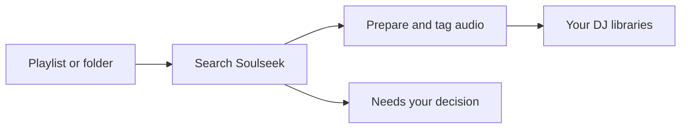

# music-agent

Give music-agent a playlist. It finds tracks, prepares audio and imports them into your DJ libraries.



Lossless files become 16-bit/44.1 kHz AIFF. Lossy files keep their format.
Default loudness is −14 LUFS / −1 dBTP. Runs can be resumed.

## Quick start

Needs Python 3.13+, `uv`, FFmpeg and `soulseek-rs`.
On macOS: `brew install michel/tap/soulseek-rs ffmpeg chromaprint`.
Other systems: install [FFmpeg](https://ffmpeg.org/download.html), Chromaprint (`fpcalc`), and [soulseek-rs](https://github.com/michel/soulseek-rs#installation).

1. Clone and install:

```sh
git clone --recurse-submodules https://github.com/alchimestre/music-agent.git
cd music-agent
uv tool install --editable .
```

2. Copy settings:

```sh
cp config.example.toml config.toml
cp .env.example .env
```

3. Set installed collections in `[export] targets`.
4. Fill `MUSICBRAINZ_CONTACT`, `ACOUSTID_API_KEY`, `SLSK_USERNAME` and `SLSK_PASSWORD` in `.env`.
5. Load credentials and run:

```sh
set -a; . ./.env; set +a
music-agent run --tracks path/to/tracklist.txt
```

Reload `.env` in each terminal.
Inputs: tracklist, audio folder or public playlist URL.
YouTube also needs `yt-dlp` on `PATH`.

## Commands

| Command | Use |
|---|---|
| `run --tracks TRACKS` | Search, process, import and sweep |
| `status` | Progress; add `--queue`, `--files` or `--json` |
| `review --list` | Show tracks needing a decision |
| `acquire`, `process`, `import` | Resume a stage |
| `reconcile`, `retag` | Rebuild run records or genres |
| `dedupe`, `backfill`, `sweep` | Preview fixes; `--apply` writes |
| `tidy` | Report leftovers |
| `peers` | Show peers that deliver nothing |

Use `run` normally. Stage commands resume interrupted work.
`--target NAME` selects collections; `--without NAME` excludes them.
`--passes N` repeats searches. `--job ID` selects a run.
Without `--job`, the CLI uses the newest unfinished run, or newest run if all are finished.

## Review

Use numbers from `review --list`.

| Command | Result |
|---|---|
| `review --accept 12 --candidate 2` | Download and process candidate 2 |
| `review --skip 12` | Leave the track for later |
| `review --not-found 12` | Stop searching in this run |

Genres use music-tagger's taxonomy. Unmatched genres stay blank.

## Collections

Set `[export] targets` to `rekordbox`, `traktor` or both.
Missing targets are skipped. Failed targets keep the run open.
Close rekordbox or Traktor before importing.
Processing can keep files without collection exports.
Traktor uses [traktor-nml](https://github.com/alchimestre/traktor-nml).
Genres use `[genres] taxonomy`; lossless upgrades keep the collection genre.

## Windows desktop

Build on Windows from the repository root.

1. Initialize the converter and install dependencies:

```sh
git submodule update --init
uv sync --extra desktop --group windows-build
```

2. Stage bundled programs:

```sh
uv run python packaging/windows/stage.py
```

3. Build and package:

```sh
uv run pyside6-deploy
uv run python packaging/windows/assemble.py build/windows
```

The ZIP is `build/windows/music-agent-windows-unsigned.zip`.
Extract it and open `music-agent.exe`.
Enter credentials in Settings, validate, then save.
Add a playlist or tracklist, preview it, then add the preview.
The desktop app and CLI use separate settings and jobs.
The desktop can save secrets in the OS credential store.
Use the desktop's `config.toml` with CLI `review` for tracks needing a decision.

## Spotify playlists

Account commands use [spogo](https://github.com/steipete/spogo), an unofficial client with undocumented endpoints.
Install and log in on macOS:

```sh
brew install steipete/tap/spogo
spogo auth import --browser safari
```

Treat the browser cookie cache like a password.
Use `music-agent spotify --help` for playlist commands.
`spotify run --remove-delivered` requires a current success receipt from every target for each duplicate.
`reconcile --job ID` previews removal; add `--apply` to apply it.
Verify duplicates before removal. Unrelated additions are preserved.
Concurrent edits to the same URI can race with removal.
Use `music-agent status --job ID --json` to check delivery receipts.
Missing or changed audio invalidates a success receipt.
See the [project guide](skill/SKILL.md) for full instructions.

## Settings and network

CLI config: repository `config.toml`, or `~/.config/music-agent/config.toml` when installed.
Use `--config PATH` for another file.
The CLI does not load `.env`; source it in each terminal.
Default Soulseek port: `20000`. Forward it on your router.
Close other Soulseek clients before a run. One account supports one client.
The `soulseek-rs` daemon stays running between runs.

## MCP tools

Install with `uv sync --extra mcp`.

| Tool | Use |
|---|---|
| `run_playlist(source)` | Start a Spotify run |
| `pass_status(job_id)` | Read progress and delivery |
| `deliver_pass(job_id, apply=false)` | Preview or apply delivery |
| `cleanup_playlist(job_id, scope="acquired", apply=false)` | Preview or remove acquisitions |

The server reads `config.toml` and `.env`. Keep it running during a pass.
Cleanup defaults to acquisitions; `scope="delivered"` includes held tracks.

## Tests

```sh
uv run pytest -q
```

Optional desktop and MCP tests:

```sh
uv run --extra desktop --extra mcp pytest -q
```

Close rekordbox for the collection-copy test. Tests need no `.env`.

## License

[MIT](LICENSE).
